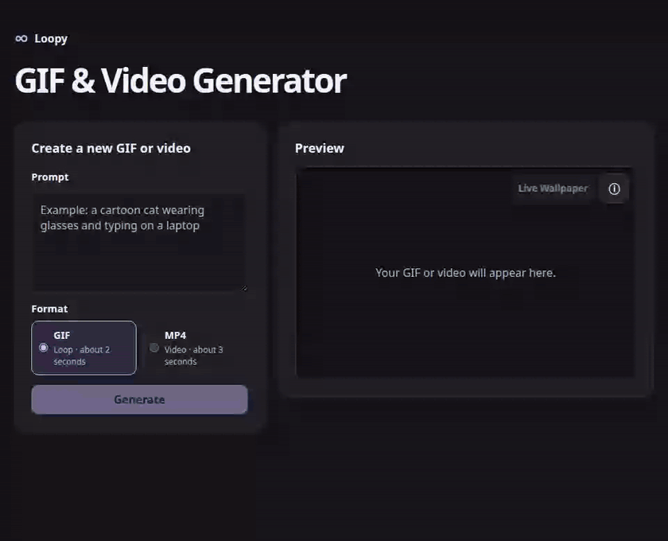
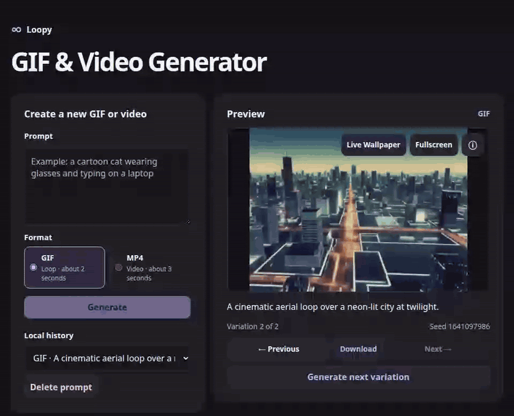

# Loopy

Generate GIFs and MP4 videos from text prompts with React, Express, and the LTX-Video Space on Hugging Face.

## Configure your Hugging Face token

You need a Hugging Face access token for authenticated GIF and MP4 generation. Set `HF_TOKEN` in `backend/.env` when running locally, or in the project root `.env` when using Docker Compose. [Hugging Face access token guide](https://huggingface.co/docs/hub/security-tokens)

```dotenv
HF_TOKEN=hf_your_token_here
```

For local setup, copy `backend/.env.example` to `backend/.env` if it does not exist yet. Restart Loopy after changing the token. Saved wallpapers can play without a token.

## Demos

These recordings use sample media and shortened waits.

### 1. Generate a GIF


### 2. Generate an MP4



### 3. Start and stop Live Wallpaper



### 4. Cycle between a saved GIF and MP4


### 5. Toggle fullscreen controls


## Run locally

Requires Node.js 20.19+ or 22.12+.

```sh
npm ci
npm run dev
```

Open http://127.0.0.1:5173. To serve the production build through Express, run `npm run build` and then `npm start`. Open http://127.0.0.1:3001.

Choose GIF for a two-second loop or MP4 for a three-second video. **Generate next variation** reuses the current prompt and format with a new seed. Loopy opens the latest result automatically. Use the preview controls to browse, download, or view a result in fullscreen.

Select **Live Wallpaper** to cycle through all saved GIF and MP4 variations. Each plays for 15 seconds by default. If history is empty, enter a prompt and choose a format to generate the first wallpaper. Set `WALLPAPER_INTERVAL_SECONDS` to a positive whole number in `backend/.env` to change the interval, then restart the backend and refresh the page. Select **Live Wallpaper** again to stop. Fullscreen automatically hides the controls. Use **ⓘ** to toggle them in either view.

With Live Wallpaper stopped, select an entry in **Local history** and click **Delete prompt** to remove all saved GIFs and MP4s with exactly the same prompt text.

Loopy creates `backend/data/history.json` and `backend/outputs/` when it saves the first result. Run one backend process per storage directory. To back up the history and generated media, copy both `backend/data/` and `backend/outputs/`.

Loopy uses `ffmpeg-static` to create GIFs when it is available. It can also use FFmpeg from `PATH` or the `FFMPEG_PATH` setting in `backend/.env`.

## Run with Docker

```sh
docker compose up --build -d
```

Open http://127.0.0.1:3001. Compose keeps its own history and generated media in named volumes that persist after `docker compose down`. Set `HF_TOKEN` and `WALLPAPER_INTERVAL_SECONDS` in a `.env` file at the project root or export them in your shell before starting Compose. To apply a changed interval, run `docker compose up -d` and refresh the page. The image includes FFmpeg for GIF generation.
